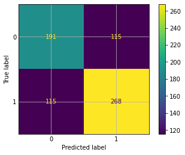
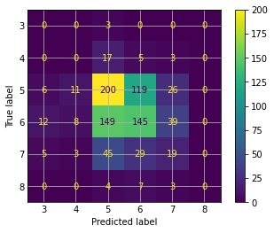
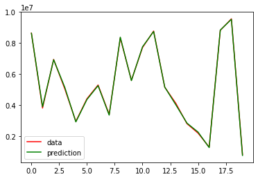

# k-Nearest Neighbours

**Classification and regression with k-NN on three datasets**

   

## Overview

Supervised learning with **k-Nearest Neighbours**: preprocessing, training and prediction, evaluation with
cross-validation and comparison of real and predicted values.

| Notebook | Problem | Target | Result |
| --- | --- | --- | --- |
| [Heart](https://colab.research.google.com/github/Steven-Macas/SAA/blob/main/heart_SAA_stevenMacas_Nearest_Neighbour.ipynb) | Classification | Heart disease (yes / no) | 66.6 % accuracy |
| [Wine](https://colab.research.google.com/github/Steven-Macas/SAA/blob/main/vino_SAA_stevenMacas_Nearest_Neighbour.ipynb) | Classification | Wine quality | 42.4 % accuracy |
| [Paris housing](https://colab.research.google.com/github/Steven-Macas/SAA/blob/main/paris_SAA_stevenMacas_Nearest_Neighbour.ipynb) | Regression | House price | Predictions closely follow real prices |

Compared with the decision trees in [ArbolDecision](https://github.com/Steven-Macas/ArbolDecision), k-NN performs
worse on the heart (66.6 % vs 80.1 %) and wine (42.4 % vs 56.3 %) classification problems.

## Results

<table>
  <tr><td align="center" valign="top"> Heart – confusion matrix</td><td align="center" valign="top"> Wine – confusion matrix</td><td align="center" valign="top"> Paris housing – real vs predicted</td></tr>
</table>

*The notebooks are written in Spanish.*

---

Made by <b>Steven Macas</b> — Data Engineer &amp; Data Analyst · <a href="https://gointy.com">gointy.com</a> · <a href="https://www.linkedin.com/in/steven-macas">LinkedIn</a> · <a href="https://github.com/Steven-Macas">GitHub</a>
